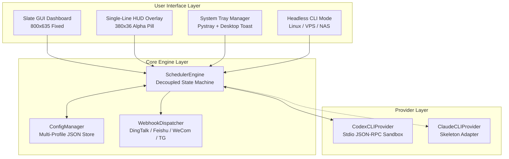

<div align="center">

# ⚡ Codex-5H-Reset

### AI CLI 额度管家与 5 小时自动对齐工具
**Next-Generation AI CLI Quota Sentinel & 5-Hour Auto-Alignment Assistant**

[](https://github.com/understand8/Codex-5H-Reset/actions/workflows/ci.yml)
[](https://github.com/understand8/Codex-5H-Reset/releases)
[](LICENSE)
[](https://www.python.org/)
[](#)
[](#-零外网遥测审计承诺-zero-telemetry-guarantee)

[简体中文](#-简体中文) | [English](#-english)

</div>

---

<a name="-简体中文"></a>
## 🇨🇳 简体中文

### 💡 为什么需要 Codex-5H-Reset？
Codex CLI 拥有强大的工程辅助能力，但其额度遵循 **5 小时动态滚动窗口（5-Hour Rolling Limit）** 与 **每周总额度（Weekly Limit）**。
- 当 5 小时额度耗尽（0%）后，服务端只有在**额度重置时间到达且收到第一条新请求时**，才会正式激活开启下一个 5 小时计算周期。
- 如果人在睡眠或离开电脑，未及时手动发送消息触发新周期，数小时的宝贵额度窗口就会被白白荒废。

**Codex-5H-Reset** 专为此痛点而生：开机常驻后台，自动精确对齐服务端重置时间点（`resetsAt + 2m`）发送一条极简心跳唤醒新窗口；同时提供极客级单行桌面悬浮条、跨平台无头守护进程、多账号轮换及多渠道移动端 Webhook 推送。

---

### ✨ 核心特性

| 功能模块 | 特性说明 |
| :--- | :--- |
| ⏱️ **5小时周期全自动对齐** | 实时获取服务端 `windowDurationMins: 300` 窗口，在重置后 2 分钟全自动发送微型激活心跳，不浪费任何一个 5 小时周期。 |
| 🪟 **单行极简胶囊悬浮窗 (HUD)** | 仅 `380x36` 的赛博风单行胶囊悬浮窗，精确显示 `2H %` 与 `Week %`，支持右键快捷菜单、滚轮调节透明度（0.40~1.00）、拖拽防出界与置顶图钉。 |
| 🖥️ **无头后台守护进程 (Daemon)** | Core 调度引擎完全解耦，支持在纯 Linux 服务器、VPS、NAS、树莓派等无图形化环境下长期平稳守护运行（`python main.py daemon`）。 |
| 👥 **多账号 Profile 隔离管理** | 支持配置与切换多个 Codex 账号目录（`~/.codex`、`~/.codex-work`），多账号开发者可在 CLI 或配置中秒级切换。 |
| 🔔 **多渠道 Webhook 移动端推送** | 支持接入 **钉钉、飞书、企业微信、Telegram Bot、Server酱** 及通用 HTTP Webhook，额度重置与激活成功瞬时推送到手机。 |
| 🔌 **开放式 Multi-CLI 扩展架构** | 采用抽象 Provider 模式，已深度适配 Codex CLI 原生 JSON-RPC 通信，预留 Claude Code、Copilot CLI 等额度扩展骨架。 |
| 📦 **单文件免安装即开即用** | 提供开箱即用的 Windows `.exe` 单文件绿色版本，无需配置 Python 环境，双击即用。 |
| 🛡️ **100% 零外网隐私遥测承诺** | 开源透明，无任何第三方数据采集或远程分析代码，所有 IPC 通信与额度探测完全限制于本地。 |

---

### 🖼️ 界面展示

#### 1. 单行桌面极简悬浮条 (Single-Line HUD)
```text
┌─────────────────────────────────────────────────────────────┐
│ ⚡ 5H: 48%  •  Week: 92%  │  ⏳ 00:43:33  │  [📌]  [✕]      │
└─────────────────────────────────────────────────────────────┘
  ↑ 右键弹出快捷菜单 (立即刷新 / 复制额度 / 隐藏)
  ↑ 鼠标滚轮滑动：平滑调节透明度 0.40 ~ 1.00
```

#### 2. Slate 现代化仪表盘 (固定尺寸 800x635)
- **额度与账号状态**：清晰卡片展示 5 小时剩余百分比、每周剩余百分比、普通额度状态与活跃 Profile。
- **自动对齐运行状态**：醒目的绿色/琥珀色运行指示横幅，显示距下次发送的实时倒计时。
- **实时运行日志**：带时间戳的黑曜石终端日志窗，掌握每次额度对齐与心跳发送细节。

---

### 🚀 快速上手

#### 方式一：下载单文件免安装版（推荐，Windows 用户）
1. 前往 [Releases 页面](https://github.com/understand8/Codex-5H-Reset/releases) 下载最新的 `Codex-5H-Reset.exe`。
2. 双击运行即可打开现代仪表盘与桌面悬浮窗，点击右上角关闭按钮将自动最小化到系统托盘静默运行。

#### 方式二：从源码运行
```bash
# 克隆代码
git clone https://github.com/understand8/Codex-5H-Reset.git
cd Codex-5H-Reset

# 安装依赖
pip install -r requirements.txt

# 运行桌面 GUI 仪表盘
python main.py
```

---

### 💻 终端与无头守护进程模式 (Headless CLI / Linux VPS)

在无显示器的 Linux 服务器、VPS 或 NAS 上，可直接使用内置 CLI 子命令：

```bash
# 启动常驻无头后台守护进程
python main.py daemon

# 查看当前额度状态与重置倒计时
python main.py status

# 手动从 Codex CLI 刷新最新额度
python main.py check

# 立即发送一次激活心跳
python main.py send

# 多账号 Profile 管理
python main.py profile --list
python main.py profile --switch work
python main.py profile --add work "工作账号" /home/ubuntu/.codex-work
```

#### Linux Systemd 服务配置范例 (`/etc/systemd/system/codex-reset.service`)
```ini
[Unit]
Description=Codex 5H Reset Headless Daemon
After=network.target

[Service]
Type=simple
User=ubuntu
WorkingDirectory=/home/ubuntu/Codex-5H-Reset
ExecStart=/usr/bin/python3 /home/ubuntu/Codex-5H-Reset/main.py daemon
Restart=always
RestartSec=10

[Install]
WantedBy=multi-user.target
```

---

### 🔔 Webhook 移动端推送配置

在配置目录中的 `config.json` 里添加或修改 `webhooks` 节点（软件首次运行后自动生成在 `~/.codex_timer/config.json` 或程序运行根目录下）：

```json
{
  "webhooks": [
    {
      "channel": "dingtalk",
      "url": "https://oapi.dingtalk.com/robot/send?access_token=YOUR_TOKEN",
      "enabled": true
    },
    {
      "channel": "feishu",
      "url": "https://open.feishu.cn/open-apis/bot/v2/hook/YOUR_TOKEN",
      "enabled": true
    },
    {
      "channel": "wecom",
      "url": "https://qyapi.weixin.qq.com/cgi-bin/webhook/send?key=YOUR_KEY",
      "enabled": true
    },
    {
      "channel": "serverchan",
      "url": "https://sctapi.ftqq.com/YOUR_SENDKEY.send",
      "enabled": true
    },
    {
      "channel": "telegram",
      "url": "https://api.telegram.org/bot<TOKEN>/sendMessage?chat_id=<CHAT_ID>",
      "enabled": true
    }
  ]
}
```

---

### 🛡️ 零外网遥测审计承诺 (Zero-Telemetry Guarantee)

我们深知开发者对 API 凭据与本地环境隐私的高度敏感，因此郑重作出以下技术审计承诺：
1. **零第三方网络请求**：本项目源代码不包含任何百度统计、Google Analytics、Sentry 或作者自建分析服务的代码。
2. **凭据安全隔离**：与本地 Codex CLI 交互严格通过本地标准输入输出（Stdio JSON-RPC）及受限环境变量沙箱进行，不读取或修改您的 `auth.json` 敏感 Token。
3. **Webhook 纯本地直发**：所有的消息推送均由用户本地机器直接 HTTP POST 到用户指定的群机器人端点，无任何中转代理。

---

<a name="-english"></a>
## 🌐 English

### Overview
**Codex-5H-Reset** is a cross-platform sentinel designed for AI CLI heavy users. It automatically aligns with the server-side 5-hour rate limit reset cycle, triggers a minimalist heartbeat upon reset arrival, and provides an Xbox Game Bar-style single-line desktop HUD, headless VPS daemon, and multi-channel webhook dispatchers.

### Key Features
- **Auto 5-Hour Cycle Alignment**: Listens to server-side `windowDurationMins: 300` reset timestamps and dispatches a lightweight wake-up message at `resetsAt + 2m`.
- **Single-Line Cyber HUD Overlay**: Compact `380x36` pill widget with right-click menu, mouse-wheel transparency adjustment (0.40 ~ 1.00), drag pinning, and screen edge clamping.
- **Headless Daemon Engine**: Decoupled core engine running independently without Tkinter/DISPLAY on Linux servers, NAS, and VPS.
- **Multi-Account Profile Switching**: Seamlessly manage and monitor distinct OpenAI / Codex configuration directories (`~/.codex`).
- **Webhook Alerts**: Real-time push notifications to DingTalk, Feishu, WeCom, Telegram, ServerChan, and generic HTTP endpoints.
- **Zero Telemetry Guarantee**: 100% auditable local execution with zero tracking and zero external telemetry.

### Headless CLI Usage
```bash
# Start daemon mode
python main.py daemon

# Check quota status
python main.py status

# Inspect raw limits from CLI
python main.py check --raw

# Profile management
python main.py profile --list
python main.py profile --switch work
```

---

## 🏗️ 架构概览 (Architecture)



---

## 📄 开源许可与免责声明 (License & Disclaimer)

本项目基于 [MIT License](LICENSE) 开源发布。

> **免责声明 (Disclaimer)**:
> 本项目为开源社区第三方辅助工具，与 OpenAI、Anthropic 等公司无任何官方隶属或赞助关系。请合理使用 AI CLI 提供的服务与额度。
